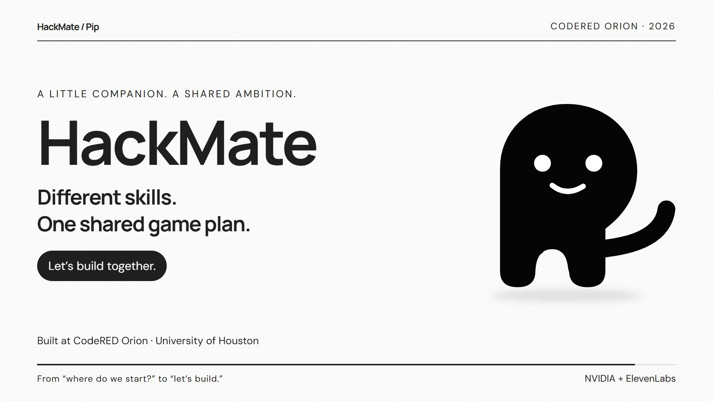

# Pip · HackMate

An assistant-first hackathon companion: introduce your team, attach the event rules, and talk through a realistic project and game plan. Pip has 30 SVG gestures and can grow extra arms for multitasking.

## Watch the launch video

Meet HackMate in this **25-second launch film for CodeRED Orion**: animated Pip, real app screens, and the story of how HackMate inspired Shiftboard.

[](https://github.com/iamcobi/CR-hack-bot/blob/main/docs/media/hackmate-launch.mp4)

**[Watch the video](https://github.com/iamcobi/CR-hack-bot/blob/main/docs/media/hackmate-launch.mp4)** · **[Download the MP4](https://raw.githubusercontent.com/iamcobi/CR-hack-bot/main/docs/media/hackmate-launch.mp4)**

1080p, with music and sound effects. This is a designed product film using real app screenshots; the Shiftboard schedule uses demo data.

Created with the [brag skill](https://github.com/latent-spaces/brag) and Hyperframes. Music: “Happy Beats / Business Moves vol 12” by ende.app, bundled with brag. Sound effects: Kenney (CC0). Fonts: Manrope and DM Sans.

## Run on your own computer

### Windows: double-click launcher

1. Install [Node.js LTS](https://nodejs.org/) (22.13 or newer). Restart any open terminals after installation.
2. On GitHub, choose **Code → Download ZIP**, then **Extract All**. Open the extracted folder containing `START-PIP.bat`. Do not run it from inside the ZIP.
3. Double-click **START-PIP.bat**. On the first run it installs dependencies and creates `.env` from the example. Internet access is needed for installation and live AI/voice.
4. For live Pip, open `.env` in a text editor and fill in your own `NVIDIA_API_KEY` and `ELEVENLABS_API_KEY`. Save it, stop the server with Ctrl+C, then click the launcher again. Never share this file or commit your keys. You can explore Demo mode in Settings without keys.
5. The launcher starts the server and opens **http://127.0.0.1:5173/** once it is ready. Keep the terminal window open while using Pip; press Ctrl+C to stop it.

Your team, documents, and conversation stay in your browser on this computer. The repository does not include the creator's API keys or private workspace. Use the same browser and URL to return to your saved workspace.

If the launcher says Node is missing, install Node.js and reopen it. If dependency installation fails, check your internet connection and try again. Only one server can run from a project folder at a time. If port 5173 is in use, close the other server window first. For a different port, set `PIP_PORT` in a terminal before launching; changing ports creates a different browser workspace.

### macOS/Linux or terminal setup

Use Node.js 22.13 or newer:

```sh
npm install
cp .env.example .env
# Add your own NVIDIA and ElevenLabs keys to .env.
npm run dev
```

On Windows, the equivalent copy command is `Copy-Item .env.example .env`. Open **http://127.0.0.1:5173/**.

NVIDIA is the default brain. The separate Gemini adapter can be configured later. ElevenLabs handles microphone transcription and Chris's expressive voice; the configured voice model is V4 Turbo. Account availability and quotas depend on your provider accounts.

## How it works

- `app/page.tsx` runs the conversation and applies validated changes to the workspace.
- `lib/hackmate/intake.ts` asks for the event, team, prior experience, goal, official documents, and available time. Unknown details require an explicit answer.
- `lib/hackmate/team-introduction.ts` immediately saves common self-introductions. More complex speech goes to the AI and must return real operations.
- `lib/hackmate/read-pdf.ts` renders image-only pages and runs local Tesseract OCR. `pdf-text.ts` preserves page sections; `read-documents.ts` keeps readable files even when another file fails. OCR workers and English language data ship under `public/ocr`.
- `lib/hackmate/ai.ts` calls the selected provider and validates replies. An unsupported claim that a change was saved is rejected.
- `lib/hackmate/operations.ts` applies a whole action batch atomically.
- `hooks/use-companion-voice.ts` records, transcribes, and speaks. Safe conversational replies begin speaking their first completed sentence while the rest arrives; later speech queues without interrupting it. Changes are confirmed after validation.
- `lib/hackmate/diagnostics.ts` keeps the last 500 metadata events in a separate local IndexedDB database, including across workspace resets. Export them under Settings. Logs exclude conversation text, attachments, audio, and keys. Server request IDs connect browser events to server console logs.

Team and plan data persist in the browser. Official materials guide recommendations; public search excerpts and previous projects are inspiration, not proof of this year's rules.

## Check it

```sh
npm test
node node_modules/typescript/bin/tsc --noEmit
npm run build
```

There are 93 automated checks covering actions, intake, streaming, voice lifecycle, and the missing-team regression. Provider and microphone tests use synthetic data or mocks. Actual microphone use requires browser permission.

See [START-HERE.md](START-HERE.md) for a beginner-friendly walkthrough and [MOTION-CATALOG.md](MOTION-CATALOG.md) for every gesture.

GitHub and Discord account integrations, shared multi-user state, and the desktop floating companion are future work. PDFs use embedded text when available and local OCR for image-only pages, including with the NVIDIA provider. Each file may be up to 50 MB; PDFs are limited to 80 pages and 100,000 extracted characters. Very small or stylized lettering may still be imperfect.
